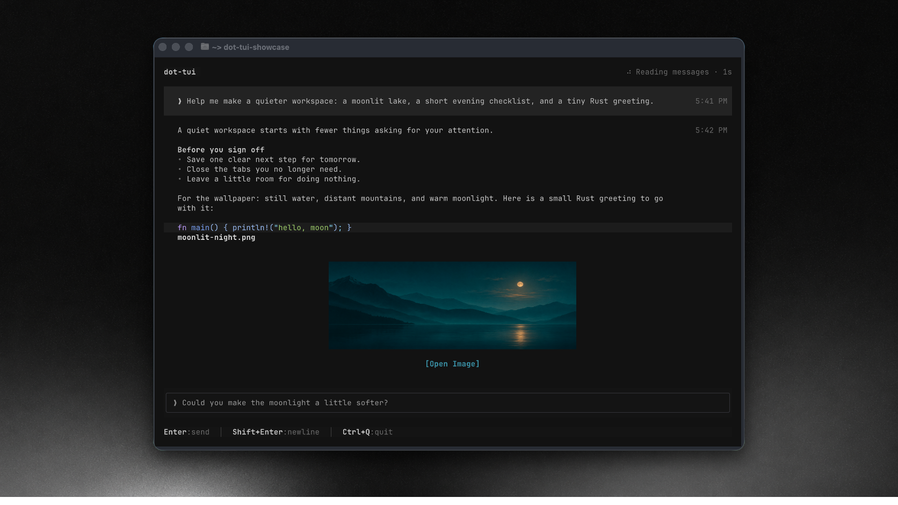

# dot-tui

A terminal UI (TUI) for ChatGPT dot, using your existing Codex login.



## Install

**macOS / Linux / Git Bash**

```sh
curl -fsSL https://github.com/cfngc4594/dot-tui/releases/latest/download/install.sh | bash
```

**Windows PowerShell**

```powershell
irm https://github.com/cfngc4594/dot-tui/releases/latest/download/install.ps1 | iex
```

## Run

Sign in to Codex with your ChatGPT account and start a dot conversation in the official app. Then run:

```sh
dot-tui
```

Uses your existing Codex login. The ChatGPT backend integration is experimental.

[Apache 2.0](LICENSE)
